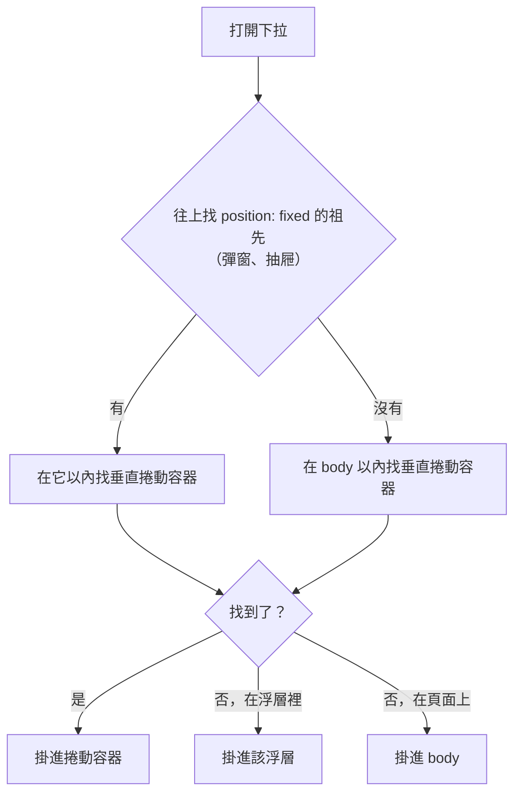

> 下拉面板掛在 body、用 `position: fixed` 定位，看起來最不會被裁掉，實際上碰到捲動容器、吸頂列、帶 transform 的彈窗就一路出錯。這篇記錄最後的做法：**把面板掛回它所在的捲動容器，讓瀏覽器自己帶著捲動與裁切。**

## 🧭 原本的寫法與三個症狀

一個桌面版的下拉選單元件，展開時面板用 portal 掛到 `body`，`position: fixed`，座標在打開當下用 `getBoundingClientRect()` 算一次。

這個寫法本來是為了解決另一個問題：彈窗內容層帶 `transform`，裡面的 `fixed` 會改成以那個祖先為定位基準，面板因此飛掉或被裁掉。掛到 body 就躲開了。

但它帶來三個新症狀：

1. **捲動脫位**：展開後捲動頁面，下拉框跟著內容走，面板留在原地，浮在不相干的區塊上
2. **蓋住頁首**：下拉框捲到頁首底下時，面板還在頁首上面
3. **蓋住後開的彈窗**：表單彈窗裡的下拉開著時，送出失敗跳出錯誤提示彈窗，面板壓在新彈窗上

原因各自很單純：

- 座標只在打開時算一次，**只有 resize 會重算，捲動不會**
- 那個 resize 監聽還是每次 render 新建的函式，`removeEventListener` 拿到的引用對不上，**監聽實際上移不掉**
- 層級寫死成全站最高一級的浮層值（1900），比頁首、吸頂列、彈窗都高

> [!IMPORTANT]
> 這三個症狀是同一個根源：面板脫離了它視覺上所屬的那一層。DOM 掛在 body，層級又是全域最高，自然誰都蓋得過。

## ❌ 先試過、被否決的做法

| 做法 | 結果 |
|---|---|
| 監聽捲動，重算 `fixed` 座標 | 能貼住，但下拉框捲出畫面時面板仍蓋在頁首上；本質還是 JS 追著捲動跑 |
| 面板放回原位，`absolute; top: 100%` | 打開後直接「不見」：列表頁的篩選列外層是 `overflow-x: auto`（窄螢幕橫向捲動），面板被裁掉 |
| 頁面上的層級降到 120 | 還是高於吸頂列（z-40／z-50），捲到吸頂列底下時蓋在上面 |
| JS 用 `clip-path` 依捲動容器可見區裁切 | 快速捲動時慢一幀，看得到切割感 |
| 打開期間鎖住捲動 | 使用者體驗上不接受，直接否決 |

第二列值得多說一句：`overflow-x: auto` 只要求水平捲動，但規格上另一軸的 `visible` 會被算成 `auto`，所以垂直方向一樣會裁切。「我只開了橫向捲動」不代表面板能往下溢出。

## ✅ 做法：掛回所在的捲動容器

定位交給定位函式庫（例如 Floating UI 的 `autoUpdate`），面板寬度等於下拉框。真正的改變在於**面板掛在哪裡**：打開時從下拉框往上找，依序挑：



「垂直捲動容器」的判斷要排除只橫向捲動的那種：

```ts
function findScrollHost(from: HTMLElement, boundary: HTMLElement) {
  for (let el = from.parentElement; el && el !== boundary; el = el.parentElement) {
    const { overflowY } = getComputedStyle(el)
    // 只認真的能垂直捲動的容器，略過 overflow-x: auto 的篩選列
    if (/(auto|scroll)/.test(overflowY) && el.scrollHeight > el.clientHeight) return el
  }
  return null
}
```

掛進捲動容器之後：

- **捲動**：面板和下拉框在同一個捲動內容裡，瀏覽器一起移動，不用任何 JS
- **裁切**：捲出可見區由容器的 overflow 裁掉，和其他內容同一幀
- **吸頂列**：在同一個層疊脈絡裡，層級比吸頂列低就會被自然蓋住

> [!WARNING]
> 捲動容器如果是 `position: static`，絕對定位的面板會以更外層為基準。打開前先暫設 `position: relative`，關閉或卸載時還原。**而且要在面板 render 之前設好**：先 render 再改，定位函式庫會用舊基準算出位置，之後容器內捲動又不會觸發重算。

浮層的辨識也不要靠 class 名稱。有些彈窗外層不是共用的彈窗容器 class，用「第一個 `fixed` 祖先」判斷才抓得到。

## 🧱 層級跟著所在的圖層走

層級不再是一個全域值，而是看面板屬於哪一層：

| 面板所在 | 層級 | 效果 |
|---|---|---|
| 頁面上 | 30：高於內容卡片（≤ 10），低於吸頂列、頁首、頁尾導覽 | 捲進吸頂列底下時被蓋住 |
| 浮層裡 | 浮層層級，且 DOM 在該浮層內 | 成為彈窗的一部分，後開的彈窗連同面板一起蓋住 |

> [!TIP]
> 給面板一個最高層級、再逐一排除例外，永遠排不完。portal 目標和 z-index 一起依「它屬於哪一層」決定，後開的東西自然會在上面。

## 👆 點外面關閉：捕獲階段取代透明遮罩

原本「點外面關閉」靠一層全螢幕透明遮罩。改完掛載點後，QA 回報：某個彈窗裡的下拉選項點不到。

原因是那個彈窗的內容層帶 `transform`，自成一個層疊脈絡。面板掛在裡面，z-index 再高也只在那個脈絡內比較；遮罩掛在外面，整個脈絡都在它底下。

遮罩是「多一層 DOM 去擋點擊」，只要有層疊脈絡就可能被打敗。改成在捕獲階段攔截點擊，完全不需要額外的 DOM：

```ts
function onOutsideClick(e: MouseEvent) {
  const target = e.target as Node
  if (panel.contains(target) || trigger.contains(target)) return
  // 只關閉下拉，不讓這次點擊觸發底下的元素
  e.preventDefault()
  e.stopPropagation()
  close()
}

// 掛 window 而不是 document
window.addEventListener('click', onOutsideClick, { capture: true })
```

為什麼是 `window`：專案裡另有一個全域監聽在 `document` 捕獲階段攔截連結點擊（把特定連結改成開彈窗），而且註冊得比較早。下拉也掛在 `document` 捕獲階段時，它先執行，下拉開著點頁首的搜尋連結照樣會跳頁。

捕獲階段由外往內傳遞，`window` 在 `document` 之前。掛到 `window` 就保證先拿到點擊，`preventDefault()` 加 `stopPropagation()` 之後，後面的連結攔截不會再把這次點擊當成跳頁。

> [!IMPORTANT]
> 同一個階段有多個全域監聽時，執行順序是「誰先註冊」。不想跟註冊時機賽跑，就往更外層掛。

## 🔍 怎麼驗才算驗完

這次有兩個盲點差點讓錯誤溜過：

- **`element.click()` 不做命中測試**：它直接對元素派發事件，不管畫面上那個位置最上層是誰。被遮罩擋住的選項，用 `click()` 測一樣「點得到」。改用真實輸入事件（瀏覽器自動化工具的滑鼠點擊），或至少用 `document.elementFromPoint()` 在面板範圍內取樣，確認最上層是面板本身
- **捲一點不算數**：要一路捲到面板完全消失。捲 100px 時面板貼得好好的，捲到吸頂列底下才會露出「還蓋在上面」的問題

驗證腳本每一步捲 150px，每一步都檢查：

1. 面板和下拉框的間距是否不變（有沒有脫位）
2. 在「可見區上緣」以上取樣，最上層是不是面板（有沒有蓋過吸頂列）
3. 直到面板底部離開可見區才算通過

另外用程式觸發錯誤提示與提示彈窗，確認下拉開著時，新彈窗會蓋住面板。

## 📌 結論

- **能交給瀏覽器的捲動與裁切，就別用 JS 追**：掛進同一個捲動容器，捲動和裁切都是原生的；JS 跟著修正一定慢一幀
- **z-index 依所在圖層分配**，不是全域最高
- **點外面關閉用捕獲階段攔截**，不用遮罩，就不受層疊脈絡影響
- **測試要用真實輸入、要捲到底**，`click()` 和「捲一下看看」都會漏掉被蓋住的情況
