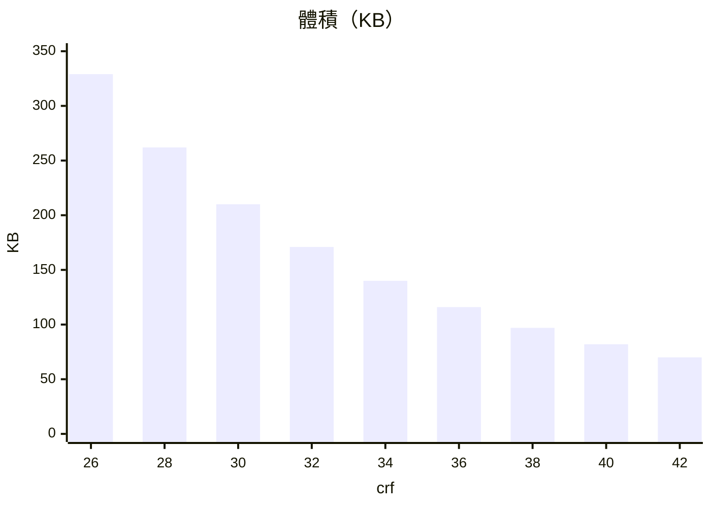

> 首頁上的卡片預覽、大圖輪播常用自動播放的短影片。素材從設計那邊交過來時什麼格式都有：GIF、ProRes 的 .mov、10-bit 的 MP4、索引放在檔尾的 MP4。這篇記錄怎麼用實測決定一套統一規格（H.264、crf 36、24 或 30fps、無音軌、尺寸為版位兩倍、循環越短越好），以及為什麼最後選擇「上傳前自己壓好、直接播放」，而不是交給 CDN 現場轉檔。

> [!NOTE]
> 作者說明：實測素材是一支 780×476 的動畫片段，細節很多，所以畫質分數整體偏低，表格請看相對高低。編碼器是 ffmpeg 的 libx264，畫質用 VMAF 衡量（0–100，越高越接近來源）。

## 一、先找出影響體積的因素

同一支影片分別調整時長、crf、解析度、preset、幀率，看體積怎麼變。由影響大到小排：

| 因素 | 實測影響 | 結論 |
|---|---|---|
| 時長 | 幾乎成正比：10.4 秒 → 4 秒，同樣 crf 26 從 989 KB 降到約 390 KB | 循環越短越好 |
| crf | 每加 2，體積少 15–20% | 主要的調整旋鈕 |
| 解析度 | 像素變 4 倍，體積約變 2.7 倍 | 做到顯示尺寸 × 2 就停 |
| preset | `veryslow` 比 `medium` 小 7–9%，畫質相同；更慢的 `placebo` 要 8.5 秒，反而大 8 KB | 一律 `veryslow`，4 秒的片轉檔只要 1.6 秒 |
| 幀率 | 60fps 只比 24fps 大約 11% | 幀率省不了多少體積 |

最後一列是最反直覺的地方。直覺上降幀率最省，但 H.264 的幀間壓縮讓多出來的幀成本很低。

**crf**（Constant Rate Factor）是告訴編碼器「要多好的畫質」，範圍 0–51，數字越小畫質越好、檔案越大。它固定的是畫質而不是碼率，所以同一個 crf，畫面越複雜檔案越大。**preset** 是編碼器花多少時間找更省空間的壓法，不改變畫質目標。素材只在上傳前轉一次，所以轉檔慢一點沒關係。

## 二、crf 定在 36

固定 4 秒、24fps、`veryslow`、780×476，從 crf 26 拉到 42：



```mermaid
xychart-beta
  title "畫質（VMAF）"
  x-axis "crf" [26, 28, 30, 32, 34, 36, 38, 40, 42]
  y-axis "VMAF" 40 --> 80
  line [78.9, 76.9, 74.3, 71.0, 67.1, 62.7, 57.3, 51.3, 45.2]
```

體積每格少的幅度差不多，畫質的線卻越往右越陡。實際數字：

| crf | 體積 | VMAF |
|---|---|---|
| 26 | 329 KB | 78.9 |
| 28 | 262 KB | 76.9 |
| 30 | 210 KB | 74.3 |
| 32 | 171 KB | 71.0 |
| 34 | 140 KB | 67.1 |
| **36** | **116 KB** | **62.7** |
| 38 | 97 KB | 57.3 |
| 40 | 82 KB | 51.3 |
| 42 | 70 KB | 45.2 |

每加 2 檔，體積穩定少 15–20%，但畫質掉的速度在加快：34 以前每 2 檔掉 2–4 分，36 以後每 2 檔掉 5–6 分。crf 36 比 crf 30 再小 45%，再往上換來的體積越來越少，畫質卻掉得越來越快。

分數只是參考。這 9 支影片後來並排放在測試頁上，用實際的卡片尺寸看過，才定在 36。比較的片段刻意選了影片最後 4 秒，因為那段疊了標題文字。crf 拉高時最先壞的是文字邊緣、暗部色塊和細小的粒子，用最難的片段比，定出來的數字才不會在別支影片上出事。

順便比了別的編碼器。同樣約 260–290 KB，H.265 與 AV1 的 VMAF 比 H.264 高 1–2 分，但不是每台裝置都能硬體解碼。首頁影片要的是「每台都能順順播」，所以留在 H.264。

## 三、幀率：24 或 30，看畫面

幀率對體積的影響小，所以不拿它來省體積，只看畫面需要：

- 動作單一、變化不大：24fps。再往下降，動作會開始卡。
- 場景複雜：30fps。從 30 抽成 24，複雜場景可能看起來略頓。

轉檔腳本直接依來源決定：來源 ≤ 24fps 就輸出 24，高於 24 就輸出 30。出片的人只要照畫面選 24 或 30 導出就好。

## 四、為什麼不經 CDN 轉檔

CDN 有現場轉影片的功能（這裡用的是 Cloudflare 的 Media Transformations），看起來很方便：上傳原檔，要什麼尺寸就在網址上帶參數。實測結果卻不適合這個情境：

| 來源 | 直接播放 | 經 CDN 轉檔 |
|---|---|---|
| 高畫質來源（crf 18） | 2,688 KB | 1,434 KB（−47%） |
| 已壓過的來源（crf 26） | 1,013 KB | 1,124 KB（**+11%**） |

CDN 對高畫質來源確實有幫助，但對已經壓好的影片反而會變大，首位元組時間也慢了 200–300 ms。經 CDN 的最好結果（1,403 KB）仍比「上傳前壓好、直接播放」（989 KB）大三成。直接播放一樣會經過 CDN 節點的快取，差別只在不重新編碼。

官方文件對輸出畫質只寫了「Outputs an H.264/AAC optimized MP4 file」，可調的參數也只有尺寸、截取時間、是否保留音軌這類，不能指定 crf、碼率或幀率。從上面的數字看，**我推測**它是用一組固定的畫質目標重新編碼，不看來源已經壓到什麼程度，但官方沒有寫明。

## 五、少了就會出事的技術項

這幾項不影響畫質，但少了任何一項，都會在某些瀏覽器上出問題：

| 項目 | 值 | 沒做到會怎樣 |
|---|---|---|
| 像素格式 | `yuv420p` 8-bit | Safari 播不出 4:4:4 與 10-bit（`NotSupportedError`）；Chrome 桌面版能播，但走軟體解碼 |
| moov 位置 | 檔頭（`-movflags +faststart`） | moov 是 MP4 的索引，放在檔尾時瀏覽器要整支下載完才開始播 |
| 音軌 | 無 | 首頁影片都靜音播放，留著只是浪費體積 |
| 寬高 | 偶數 | `yuv420p` 色度是 2×2 取樣，奇數尺寸會編碼失敗 |

前端播放也有對應的要求：`autoplay muted loop playsinline` 一個都不能少。少了 `muted`，瀏覽器不會自動播放；少了 `playsinline`，iPhone 會跳成全螢幕。另外要給 `poster`，不然載入完成前是一塊黑。不在首屏的影片用 `preload="none"`，進入畫面才給 `src`。

## 六、轉檔腳本

設計從 AE、Premiere 導出時只能調碼率，沒有 crf 這個選項，要求出片的人照指令導出不實際。所以反過來，不管交來什麼格式，都統一用一支腳本轉一次。核心指令是：

```sh
ffmpeg -i in.mov -map 0:v:0 -an \
  -vf "crop=trunc(iw/2)*2:trunc(ih/2)*2,setsar=1,fps=24,format=yuv420p" \
  -c:v libx264 -crf 36 -preset veryslow -movflags +faststart out.mp4
```

腳本包在這行外面，處理幾個細節：

- **幀率讀 `avg_frame_rate`**。GIF 的 `r_frame_rate` 常是 `100/1` 這類時間基，不是真實幀率。
- **透明來源先做 `premultiply`**。`yuv420p` 會直接丟掉 alpha，透明處顯示的是像素裡殘留的 RGB，顏色不可預期。先把 RGB 乘上 alpha，透明處一律變黑。真的需要透明的素材，就不該走影片。
- **先寫暫存檔，檢查合規才改名**。轉完用 `ffprobe` 檢查編碼、像素格式、幀率、有沒有音軌、moov 是否在前，任一項不合就刪掉。中斷或失敗留下的半成品，下次不會被當成「已轉過」而跳過。

```sh
# 幀率：來源 ≤ 24 出 24，高於 24 出 30
sfps=$(ffprobe -v error -select_streams v:0 \
  -show_entries stream=avg_frame_rate -of csv=p=0 "$in")
ofps=$(echo "$sfps" | awk -F/ '{ f = ($2 > 0) ? $1 / $2 : $1; print (f > 24.5) ? 30 : 24 }')

# moov 是否在前：看第一個出現的是 moov 還是 mdat
first=$(ffprobe -v trace -i "$tmp" 2>&1 | grep -oE "type:'(moov|mdat)'" | head -1)
[ "$first" = "type:'moov'" ] || ok=0
```

用六種故意不合規的樣本測過，每支都帶音軌，也都是各格式常見的編碼。這組測試跑在 crf 30 那一版，下面的大小是當時的結果：

| 來源 | 原本 | 轉檔後 |
|---|---|---|
| .mp4，H.264 4:4:4（Safari 不能播） | 641 KB | 219 KB |
| .mov，ProRes 10-bit（AE / PR 常見導出） | 45,488 KB | 224 KB |
| .m4v，H.264 10-bit | 756 KB | 220 KB |
| .webm，VP9 | 575 KB | 227 KB |
| .mkv，H.265 | 359 KB | 204 KB |
| .avi，MPEG-4 | 3,285 KB | 228 KB |

GIF 也能當來源，但腳本不改尺寸。兩倍尺寸要在做 GIF 時就做，不能拿一倍的 GIF 轉檔時再放大：

| 來源 | 轉成 MP4 |
|---|---|
| 一倍 GIF，390×238，1,912 KB | 54 KB |
| 兩倍 GIF，780×476，7,099 KB | 153 KB |
| 一倍 GIF 放大到 780×476 再轉 | 153 KB，體積一樣但明顯較糊 |

原本首頁上最重的一張 GIF 是 1,891 KB，轉成同解析度、同幀率的 MP4 後只剩 131 KB，少了 93%。

## 七、兩種落地方式

規格相同，差別只在誰來轉檔：

| | 快速見效：轉好再上傳 | 完整方案：後台上傳時轉 |
|---|---|---|
| 流程 | 出片 → 出片或上傳的人跑腳本 → 上傳輸出的檔 | 出片 → 後台直接上傳原檔 → 後端收檔後用同一組參數轉檔 |
| 開發成本 | 無，腳本已完成 | 後端要排期，上傳的格式限制、大小上限、逾時都要放寬 |
| 優點 | 立即生效 | 不靠人遵守，傳什麼都會被轉成規格 |
| 限制 | 靠人遵守，沒轉過的片後台一樣收；每台電腦要裝 ffmpeg | 原檔大，上傳時間變長 |

先用快速見效的方式讓規格跑起來，等確定常有人卡在轉檔這一步，再排完整方案。兩邊用的是同一組參數，換過去不用重定規格。

## 八、對照：成熟網站怎麼做

量了一個大型商業網站首頁的卡片預覽影片，作法幾乎一樣：4 秒、24fps、無音軌、素材做到顯示寬度的兩倍左右，每支 127–368 KB。載入的作法也值得學：

- `preload="none"`，一開始不給 `src`
- 卡片完整進入畫面才補 `src` 並播放，只露出一部分時不動
- 同一批可見的卡片依序啟動，每張間隔 200 ms

整頁 18 支影片，捲動一遍只下載了進入畫面的 9 支。

它的影片比我們的小，主要差在畫面複雜度：同樣 crf 26、4 秒，我們這支每個像素用的資料量約是它的 2.5 倍。所以規格只能定「壓縮程度」，不能定「每支一定多大」。體積上限要按版位另外訂。

## 結論

- 省體積的順序是：換格式（GIF → MP4）> 縮短時長 > 調 crf > 解析度不超過兩倍 > preset。幀率幾乎省不了。
- crf 用最難的片段，以實際顯示尺寸並排比較再定，分數只是參考。
- 已經壓好的影片不要再交給 CDN 轉，會變大也會變慢。
- 規格寫成腳本，連合規檢查一起交出去，比寫在文件裡要人遵守可靠。
