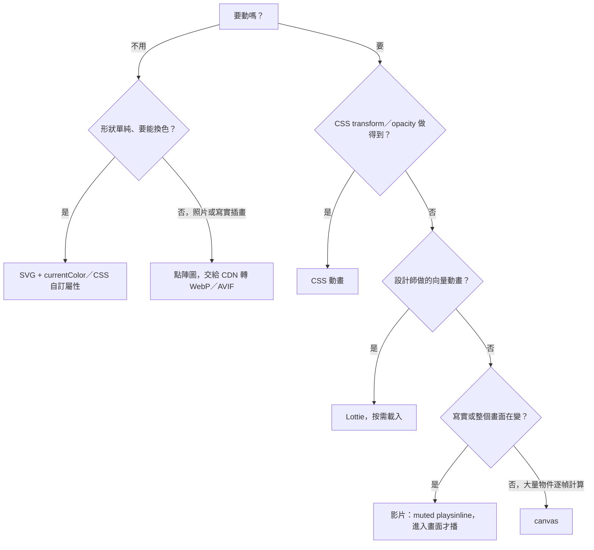

> 介面上的圖示、插圖、動畫，可以用 SVG、點陣圖、GIF、影片、Lottie 或 canvas 來做。這篇整理六種做法各自擅長什麼、代價在哪，附一個判斷順序；中段用同一段動畫實測四種輸出格式的檔案大小和畫質，結果是：沒有哪個格式永遠最小，GIF 有時候確實最小，但那是因為它把畫面丟掉了一大半。

> [!NOTE]
> 作者說明：實測素材是自己用 canvas 畫的 3 秒、30fps 動畫，以 ffmpeg 9 與 libwebp 輸出；不同內容、不同壓縮參數的數字會不一樣，文中的比例只代表這兩類內容的趨勢。

## 一、六種做法各自適合什麼

| 做法 | 適合 | 優點 | 代價 |
|---|---|---|---|
| **SVG** | 圖示、logo、少色的扁平圖形 | 向量不失真；可以用 `currentColor` 或 CSS 自訂屬性上色，換主題不用重新出圖；體積小 | 複雜插畫的路徑很龐大，解析與繪製反而慢；大量 inline 會讓 HTML 或 JS bundle 變肥 |
| **點陣圖** PNG JPEG WebP AVIF | 照片、寫實插畫、封面圖 | 美術直接產出；交給圖片 CDN 依裝置轉成 WebP／AVIF 並縮到需要的尺寸 | 每種倍率、每套配色都是一張圖；不能用 CSS 改色；放大會糊 |
| **GIF** | 幾乎只剩「一定要在不支援影片的地方動」 | 到處都能播，不需要 JS | 每幀最多 256 色；透明只有全透明或全不透明兩種；不能控制播放 |
| **影片** MP4 WebM | 寫實或長一點的動態內容，例如作品預覽 | 幀與幀之間能共用資訊，連續變化的畫面壓縮率最好；可以暫停、只在可視範圍內播放 | iOS 要 `muted playsinline` 才能自動播放；MP4（H.264）沒有透明，WebM 的透明不是每個瀏覽器都支援 |
| **Lottie** | 設計師用 After Effects 做的向量動畫，例如載入中、成功、掃描 | 檔案小、可縮放、可以控制播放進度 | 要先載入播放器的 JS；圖層太多在低階手機會掉幀 |
| **canvas** | 同時有大量物件在動：粒子、滾輪、小遊戲 | 每幀自己畫，上千個物件也撐得住 | 沒有 DOM：無障礙、SEO、點擊判定都要自己處理；要自己乘上 DPR 才不會糊 |

## 二、實測：同一段動畫，四種格式

用 canvas 畫了兩段 3 秒的動畫，各輸出成 GIF、動態 WebP、WebM（VP9）、MP4（H.264）：

- **A. 透明背景的零星粒子**：像成功提示上方炸開的煙火，畫面大部分是透明，粒子帶有半透明的光暈。
- **B. 整個畫面都在變的漸層**：像首頁背景或作品預覽，每個像素每一幀都在變。

| 內容 | GIF | 動態 WebP | WebM | MP4 |
|---|---|---|---|---|
| A. 透明背景的粒子 | **97 KB** | 1180 KB | 184～398 KB | 207 KB（沒有透明） |
| B. 整個畫面的漸層 | 2539 KB | 33 KB | **8 KB** | 17 KB |

B 的結果符合一般印象：連續變化的畫面，影片格式能利用前後幀的相似性，WebM 只有 GIF 的三百分之一。

A 卻反過來，GIF 最小。原因要看畫面：

GIF 的透明只有兩種狀態，轉檔時低於門檻的像素一律變成全透明。綠色那組粒子正在淡出，整組被當成透明丟掉；粉紅色粒子的半透明光暈變成實心的鋸齒邊。**GIF 在這裡小，是因為它存的東西少了一大半**，不是壓縮得比較好。

動起來看更明顯。下面兩段是同一個來源，左邊 GIF（97 KB），右邊 WebM（184 KB）：

  <figure style="margin:0;flex:1;min-width:240px">
    
    <figcaption style="color:#aaa;font-size:13px;text-align:center">GIF · 97 KB</figcaption>
  </figure>
  <figure style="margin:0;flex:1;min-width:240px">
    <video src="/posts/ui-media-format-tradeoffs_03-fireworks.webm" autoplay loop muted playsinline preload="none" width="480" height="360" style="display:block;width:100%;height:auto" aria-label="WebM 版的煙火：綠色與粉紅色粒子都在，光暈平滑淡出"></video>
    <figcaption style="color:#aaa;font-size:13px;text-align:center">WebM（VP9 alpha）· 184 KB</figcaption>
  </figure>

（Safari 不支援 WebM 的透明通道，右邊會是黑底；放在深色底上看不太出差別。要在 Safari 也透明，得另外準備一份帶 alpha 的 HEVC。）

另外兩個值得注意的數字：

- **動態 WebP 在 A 最大**（1180 KB）。動態 WebP 只能記錄「這一幀哪塊區域變了」，沒有影片那種跨幀預測；粒子散在整個畫面時，每幀幾乎都要重存一大塊，帶透明時還要多存一層 alpha。它適合取代短小的 GIF，不適合長一點、帶透明的動畫。
- **WebM 的大小對壓縮參數很敏感**，同一段 A 從 398 KB（較高畫質）到 184 KB（較低畫質）。要比較格式，得在相近的畫質下比，只看一組數字很容易下錯結論。

所以 A 這種「透明背景上的特效」，真正的候選不是 GIF，而是 Lottie（向量、天生透明）或帶 alpha 的 WebM；B 這種整個畫面在變的內容，影片格式壓倒性地好。

## 三、判斷順序

GIF 不在這張圖裡：它能做的事，Lottie 或影片都做得更好。

## 四、幾個實務上會踩的點

- **多主題、多配色的站，圖示優先用 SVG。** 用 `currentColor` 或 CSS 自訂屬性上色，新增一套主題只要改變數；同一個圖示每套配色各出一張 PNG，很快就會失控。
- **動畫檔不要經過圖片轉檔服務。** 圖片 CDN 的即時轉檔（縮圖、轉 WebP）只認得圖片，`.lottie`、`.json` 這類動畫檔經過它，可能被拒絕或回錯的內容；這類資源要直接從原始位置取。
- **影片自動播放要三件套。** `autoplay muted playsinline` 缺一個，iOS 上就不會自己播；捲出畫面時暫停，可以省下解碼的 CPU 和電量。
- **Lottie 和 canvas 都不要放在首屏的關鍵路徑上。** 它們都要先下載並執行 JS 才看得到東西，首屏先放靜態圖，動畫載入好再換上。
- **canvas 要處理 DPR。** 畫布的寬高是實體像素，要乘上 `devicePixelRatio`，再用 CSS 縮回原本大小，否則在高解析度螢幕上會糊。

## 五、可以帶走的原則

- **先問內容是什麼，再挑格式。** 向量圖形、寫實畫面、透明特效、大量物件，各自有最適合的做法，沒有一個格式通吃。
- **比較檔案大小，要在相近的畫質下比。** GIF 在透明特效上可能最小，但那是因為它丟掉了半透明的部分；只看位元組數會選錯。
- **GIF 已經沒有非用不可的場景。** 向量動畫用 Lottie，寫實或透明的動態用影片。
- **能用 CSS 做的就用 CSS。** 不用額外下載，瀏覽器也最容易最佳化。
