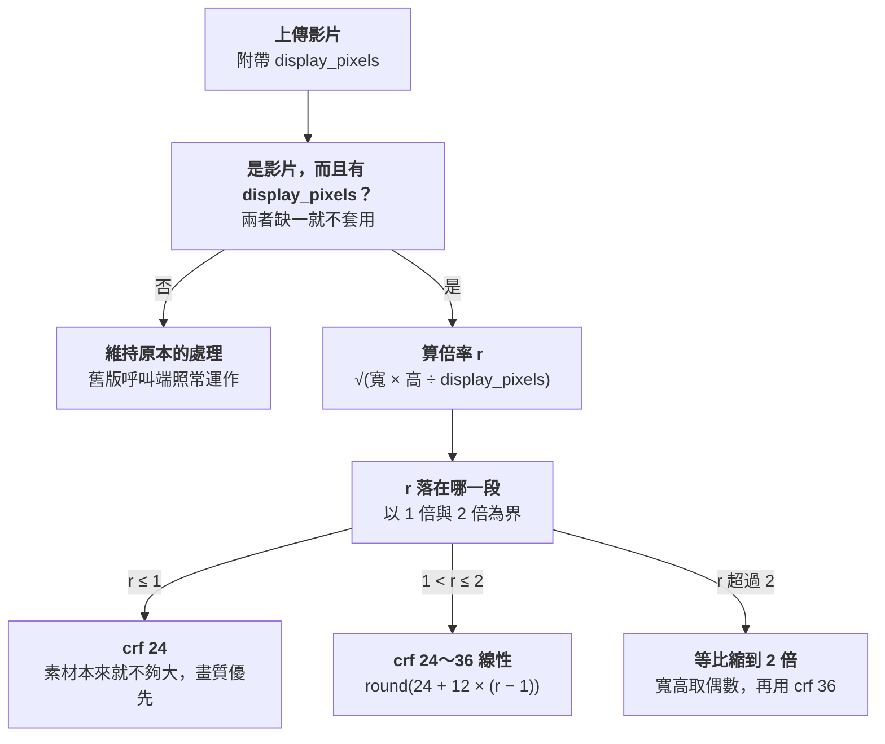

> 這篇是[首頁短循環影片的壓縮規格](/posts/short-loop-video-encoding-spec)的修正。那篇定的規格是一律 crf 36、尺寸做到版位兩倍。後來實測發現，上傳的素材如果只有 1 倍左右，固定 crf 36 會讓畫質掉 10～15 分。所以改成：**上傳時先算「素材 ÷ 版位」的倍率，再依倍率決定 crf。**

> [!NOTE]
> crf、preset、幀率的基礎，以及為什麼不交給 CDN 現場轉檔，前一篇都講過，這裡不重複。畫質一樣用 VMAF 衡量（0–100，100 代表跟原片看不出差別）。

## 🧭 問題：crf 36 是為 2 倍素材定的

前一篇的 crf 36 是在「素材為版位兩倍」的前提下定的。畫面顯示時會被縮小一半，壓縮瑕疵也跟著被縮小，所以壓重一點還看得過去。

實際上傳的素材不會都剛好 2 倍。版位是 1200×280 的橫幅，有人交 1200×280，也有人交 3000 多寬的原片。1 倍的素材以原尺寸顯示，瑕疵沒有被縮小，crf 36 就明顯糊了。

## 📐 規則：倍率決定 crf

倍率用面積換回邊長：

```
r = √(影片寬 × 高 ÷ display_pixels)
```

`display_pixels` 是版位 **1 倍顯示尺寸**的寬 × 高。例如版位 300×300、上傳 900×900，面積是 9 倍，開根號得到邊長 3 倍。

分三段：1 倍以下固定 crf 24；1～2 倍之間線性，每多 0.25 倍加 3；超過 2 倍先縮到 2 倍，再用 crf 36。



寬高比例跟版位不同時，算出來的倍率會落在寬、高兩邊倍數之間。例如 400×450 對 300×300，寬是 1.33 倍、高是 1.5 倍，算出來 1.41 倍，誤差大約 1 個 crf，可以接受。

## 📊 實測：每個倍率都比一律 crf 36

兩支近無損的動畫橫幅，各取 4 秒、24fps，先做無損參考，再縮成各倍率的尺寸。版位以 260×260 計，畫質是把成品縮到 260×260 後跟無損原片逐幀比對。素材 A 畫面較複雜，素材 B 較單純。

| 倍率 | 尺寸 | crf | A 依倍率 | A 一律 36 | B 依倍率 | B 一律 36 |
|---|---|---|---|---|---|---|
| 0.75 | 194² | 24 | 104 · 76.7 | 31 · 57.3 | 57 · 81.3 | 17 · 68.3 |
| 1 | 260² | 24 | 149 · 80.5 | 45 · 65.0 | 80 · 84.5 | 24 · 74.7 |
| 1.25 | 324² | 27 | 146 · 80.5 | 61 · 69.9 | 88 · 84.0 | 35 · 77.1 |
| 1.5 | 390² | 30 | 135 · 79.6 | 77 · 72.4 | 84 · 83.8 | 46 · 79.8 |
| 1.75 | 454² | 33 | 124 · 78.3 | 95 · 74.9 | 76 · 83.4 | 57 · 81.1 |
| 2 | 520² | 36 | 113 · 76.3 | 同左 | 71 · 82.1 | 同左 |

（格內是「體積 KB · VMAF」；尺寸 194² 指 194×194，crf 是依倍率算出的值）

兩件事：

- **依倍率的體積在 1～2 倍之間幾乎持平**：A 從 149 KB 到 113 KB，B 從 88 KB 到 71 KB。不管上傳幾倍，成品都落在 2 倍檔附近，畫質只差 2～4 分。
- **一律 crf 36 在 1 倍附近畫質低 10～15 分**，倍率越低差越多（A 在 0.75 倍差了 19.4 分）。它的體積確實比較小，但那是用畫質換來的，而且換到的是一眼就看得出來的糊。

> [!IMPORTANT]
> 這條規則不是要讓檔案更小，而是讓**每支上傳的成品都花差不多的體積、拿到差不多的畫質**。2 倍檔的體積本來就是前一篇定下的預算，1 倍附近的素材最多比它多三成左右（A 149 KB 對 113 KB）。

## ❌ 被否決的方案

| 方案 | 結果 | 不採用的原因 |
|---|---|---|
| 一律 crf 36（原規格） | 1 倍附近畫質低 9.8～19.4 分 | 小尺寸素材被壓糊 |
| 線性延伸到 2 倍以上（2.25 倍 crf 39 … 3 倍 crf 48） | 體積只少 6～38%，畫質掉 3～20 分 | 2.25 倍的畫質就已經低於 2 倍的基準 |
| 3 倍保持尺寸，只提高 crf | crf 38 才跟 2 倍 crf 36 畫質持平，但體積約 1.5 倍（173 KB 對 113 KB） | 多花體積，換不到更好的畫面 |
| **超過 2 倍先縮到 2 倍，再用 crf 36** | 成品跟直接交 2 倍的檔**逐位元組相同**（113 KB／71 KB） | 採用 |

最後一列是這個規則最乾淨的地方：交 3 倍跟交 2 倍得到的是同一支檔案，上傳的人不用管自己交了多大。

## 🔌 上傳端：多送一個 display_pixels

營運後台的每個上傳欄位本來就有「建議尺寸」的提示文字，例如橫幅影片寫 1200×280。改動只有一點：上傳時把建議寬 × 建議高算好，一起送給上傳介面。

```
POST 上傳介面
{
  "file_data": "data:video/mp4;base64,…",
  "display_pixels": 336000      // 新增：1200 × 280
}
```

- **只送一個數字，不送欄位代號**。後端不用維護「哪個欄位多大」的對照表，新增版位也不用改後端。
- **向後相容**：沒帶 `display_pixels`（舊版呼叫端），或上傳的不是影片，就維持原本的行為。
- **回應格式不變**，回傳的是轉檔後的網址。

### 計算案例

| 版位 | display_pixels | 上傳影片 | 倍率 | 縮放 | crf |
|---|---|---|---|---|---|
| 橫幅 1200×280 | 336,000 | 1200×280 | 1.00 | 不縮 | 24 |
| 橫幅 1200×280 | 336,000 | 1800×420 | 1.50 | 不縮 | 30 |
| 橫幅 1200×280 | 336,000 | 3086×720 | 2.57 | 縮到 2400×560 | 36 |
| 方形 300×300 | 90,000 | 400×450 | 1.41 | 不縮 | 29 |
| 方形 300×300 | 90,000 | 900×900 | 3.00 | 縮到 600×600 | 36 |

### 驗收

1. 依上表五個案例上傳，輸出的尺寸與 crf 都要對得上。編碼器是 x264 時，crf 會寫在檔案的編碼設定裡，用 `mediainfo` 就讀得到：

   ```sh
   mediainfo out.mp4 | grep -o 'crf=[0-9.]*'
   # crf=30.0
   ```

2. 不帶 `display_pixels` 上傳，結果跟改動前一樣。
3. 前台版位能正常播放轉檔後的影片。

## 🧱 踩到的坑

### 建議尺寸的基準不一致

盤點後台欄位時發現，提示文字寫的「建議尺寸」各有各的基準：PC 橫幅影片 1200×280 是 1 倍，PC 背景圖 2400×520 是 2 倍，手機版影片 1052×576 推測是 3 倍。這些數字一旦被拿去算倍率，3 倍的基準會讓每支上傳都被算成不到 1 倍。

> [!WARNING]
> 規則上線前，所有欄位的建議尺寸要先統一成 **1 倍顯示尺寸**。基準錯了，公式再對也沒用。

### 縮放後的寬高要取偶數

`yuv420p` 要求寬高都是偶數。等比縮放時寬高各乘上 `2 / r`，算出來常是奇數，要四捨五入到最近的偶數，否則編碼直接失敗。不縮放的奇數尺寸素材，則裁掉最右、最下 1px。

### 來源碼率不用設門檻

原本擔心上傳的原片已經被壓過，再壓一次會疊加瑕疵。實測每像素位元數（bpp）在 0.1 以上，成品看不出差別；0.05 也只有複雜畫面稍糊（A 掉 2.3 分），體積幾乎一樣。所以不設碼率門檻，只要求正常導出，不要拿從網頁或聊天軟體存下來的片當來源。

## ☁️ 順帶一提：CDN 轉檔的隱藏限制

前一篇說明過為什麼不讓 CDN 轉檔。評估時也核對了 Cloudflare 官方文件，有幾條限制不寫在功能介紹裡，但會直接影響能不能用：

| 限制 | 文件內容 | 影響 |
|---|---|---|
| 影片輸出最長 60 秒 | `duration` 預設是「輸入長度或 60 秒取較短者」，可設範圍 1–60 秒 | 長於 60 秒的影片，不寫 `duration` 會被截斷；寫了也超不過 60 秒 |
| 輸入上限 | 檔案 ≤ 100 MB、長度 ≤ 10 分鐘 | 大支原片要先在上傳端擋下 |
| GIF 轉動態 WebP 有面積上限 | 所有幀的寬 × 高 × 幀數超過 50 MP 就原樣交付 | **不報錯**，回來的還是原本那張大 GIF |
| 計費 | 輸出每秒算 1 次轉換；同一個輸入、同一組參數每月只算一次 | 每多一種寬度或參數組合，就是一個新的計費項 |

GIF 那條最容易漏掉：沒有任何錯誤，只是檔案沒變小，所以上傳時就要擋下超過 50,000,000 的 GIF。GIF 本身的取捨可以參考[介面圖像與動畫的格式取捨](/posts/ui-media-format-tradeoffs)。

計費那條決定了前台的寫法：寬度只允許固定幾種（例如手機、桌機各一種），由設定下發，不讓前台依螢幕自由組參數。

## 🔍 還沒定案的

在 3 倍螢幕上以 780px 比對，「縮到 2 倍、crf 36」比「保持 3 倍、crf 36」低 7～12 分。縮到 2 倍後改用 crf 32 就能持平（體積 161 KB／102 KB）。目前出片規格以 2 倍螢幕為準，3 倍螢幕是否改用 crf 32 還沒決定。

## 📌 結論

- 固定的 crf 只對固定的尺寸倍率成立。素材倍率會變，crf 就要跟著變。
- 1～2 倍之間線性調整，讓不同大小的上傳花差不多的體積；超過 2 倍直接縮到 2 倍，結果跟交 2 倍檔完全相同。
- 上傳端只多送一個數字，後端不必認識任何版位，沒帶的呼叫端行為不變。
- 規則能不能用，取決於「1 倍顯示尺寸」這個基準是否一致，要先盤點再上線。
